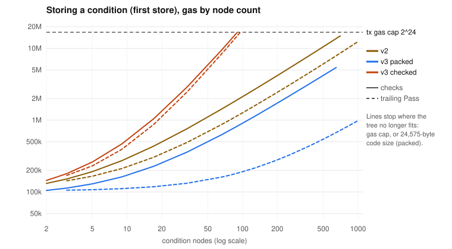
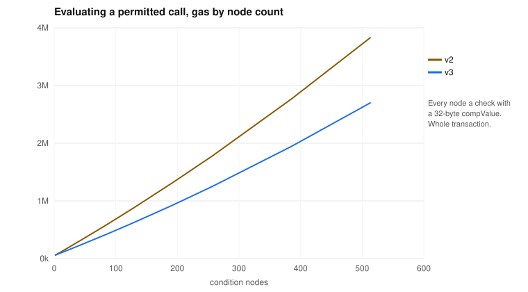

# Condition size and gas

How the gas to store and evaluate a condition grows with its number of nodes,
how large a condition can get, and why `normalizeCondition` no longer prunes
trailing `Pass` nodes.

Measured on a local Hardhat chain (2026-10-25). v2 is the Roles 2.1.0 bytecode
deployed on mainnet (`scopeFunction`, Integrity and packing on chain). v3 is
this repository, stored with `allowFunctionPacked` (the SDK path: checked and
packed off chain) or `allowFunction` (Integrity and packing on chain). The
synthetic trees are `f(uint256 × n)` with either n checks (`EqualTo`, a
32-byte compValue each) or one check and trailing `Pass` nodes. Gas is per
transaction. A store is the first store of that tree, which deploys it; storing
an already-deployed tree again (another role or function) costs about 61k.

## Storing

- v3 packed: about 8.2k gas per check node, almost all of it the node's
  bytes deployed as code (4 bytes, plus 34 for a 32-byte compValue). A `Pass`
  node costs about 0.9k.
- v2: about 20k gas per check node.
- v3 checked: Integrity grows faster than linearly with size, and faster
  still with depth (`INTEGRITY_BACKLOG.md`, item 3). A flat tree of 89 check
  nodes takes 16.4M gas.

## Evaluation

A permitted call, whole transaction. How the condition was stored doesn't
matter: both v3 setters store the same bytes.

- v3: about 4.2k gas per check node, 2.8k per trailing `Pass` (more for a
  `Pass` describing a tuple or array: about 4.2k for an array, 5.3–6.1k for a
  tuple).
- v2: about 6.2k gas per check node.
- Growth is slightly faster than linear at large sizes (memory).

## Limits

A condition must fit two mainnet limits: one transaction may use at most
2^24 ≈ 16.78M gas (EIP-7825, since Fusaka), and a stored condition is deployed
as contract code of at most 24,576 bytes (EIP-170; v3 stores the packed bytes
plus one prefix byte).

| Setter                   | Binding limit       | Check nodes (32-byte compValues) | `Pass` nodes      |
| ------------------------ | ------------------- | -------------------------------- | ----------------- |
| v3 `allowFunctionPacked` | code size           | about 647                        | about 6,000       |
| v3 `allowFunction`       | gas (Integrity)     | about 89 (flat; 8 at depth 8)    | about 95          |
| v2 `scopeFunction`       | code size, then gas | about 720                        | about 1,300 (gas) |

- These are for flat trees of one kind. A real tree mixes nodes with and
  without compValues: for v3 packed, count 4 bytes per node, plus 2 plus the
  compValue's length for each node that has one, and stay below 24,575 bytes.
- Evaluating never binds first: the largest storable v3 tree of checks
  evaluates in about 3.6M gas, 1,000 `Pass` nodes in about 4.2M.
- The packed format also caps each node at 1,023 children (10 bits) and
  65,535 nodes in all.
- Live mainnet permissions are far below the packed limits: the largest of
  2,662 distinct trees has 314 nodes, 6.9 KB, and stores for 1.6M gas. With
  `allowFunction`, 80 of them (3%) don't fit in one transaction.

## Live mainnet permissions

Every distinct condition in use on Ethereum mainnet (subgraph snapshot,
2026-10-25), stored as v2 stored it, and converted to v3 with
`migrateConditionV2`, first store:

| Stored as             | Trees | Median gas | Total gas |
| --------------------- | ----- | ---------- | --------- |
| v2                    | 2,209 | 207k       | 701M      |
| v3 packed             | 2,662 | 123k       | 393M      |
| v3 packed, if pruned  | 2,662 | 115k       | 379M      |
| v3 checked, if pruned | 2,600 | 310k       | 2,739M    |

(v3 counts a condition once per function signature it is used with, v2 once
per stored condition.)

## Why `normalizeCondition` no longer prunes trailing `Pass` nodes

Decided 2026-10-25. `normalizeCondition` used to drop the trailing `Pass`
children of a `Matches` on calldata or on a dynamic tuple. It keeps them now.

**Pruning could change which calls a permission allows.** `Pass` checks no
value, but a trailing `Pass` is not free of effect: the contract computes the
location of every child of a `Matches` before evaluating any of them
(`AbiLocation.children` in `_matches`), and fails when a location points past
the calldata. A pruned tree skips that. Example: `f(bytes b)` with
`Matches:AbiEncoded[EqualTo(1), Pass:Dynamic]` on `b` fails on
`b = abi.encode(1)`; pruned to `Matches:AbiEncoded[EqualTo(1)]`, it passes.
This matters most for an `Or` of call interpretations of one `bytes` value:
calldata of one interpretation's type is malformed for another's, so a
pruned branch could allow calldata the branch as written rejected.

**Without pruning, normalization can be proven sound on all calldata.**
Normalization then never changes how a node lays out its children, so the
proof that it keeps the verdict can follow the contract's own decoding,
for any calldata and every kind of call variant. With pruning, the proof
needed the calldata to fit one layout per value, and left call variants
with overlapping selectors uncovered (`packages/evm/formal/README.md`).

**The cost**, on the live mainnet permissions above:

- Storing: 3.6% more first-store gas (14.1M over 2,662 trees, about 5.3k
  per tree, once per tree).
- Evaluation: every kept `Pass` costs about 2.8k gas per call (up to 6k for a
  tuple). The median permission pays 2.8k more per call, the 90th percentile
  5.6k, the most 154k. 37% of permissions pay nothing extra.

A permission author who wants the saving can leave trailing parameters out of
a `Matches` (it may list only the first ones). The SDK stores the tree as
written, so the trade-off is then explicit in the condition itself.

`normalizeCondition` also merges `Or` branches only when they have exactly the
same type tree (`siblingsSameType`): a `bytes` check and a nested call, or
checks of a prefix of one tuple, stay separate branches, so the merged node
reads every parameter as each branch did.

The measurement scripts are not part of this repository.
